# ไดอะแกรมสำหรับรูปเล่ม (บทที่ 3)

ไฟล์นี้สร้างด้วย `pnpm docs:diagrams` อย่าแก้ไฟล์นี้โดยตรง ให้แก้ไฟล์ `.mmd` ใน `docs/diagrams` แล้วรันใหม่

**นำไปใส่รูปเล่ม:** เปิดไฟล์นี้บน GitHub (แสดงเป็นรูปให้เอง) หรือคัดลอกโค้ดของแต่ละไดอะแกรมไปวางที่ <https://mermaid.live> แล้วกด Export เป็น PNG หรือ SVG

## Use Case Diagram

ผู้ใช้ 3 ระดับและสิ่งที่ทำได้ ตามตารางสิทธิ์หัวข้อ 2.4 · ไฟล์ต้นฉบับ `docs/diagrams/use-case.mmd`

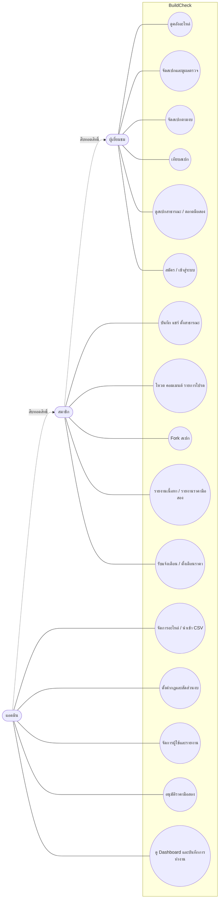

## ผังเว็บไซต์

ทุกหน้าในหัวข้อ 5.1, 5.2 และ 5.4 สีบอกสิทธิ์การเข้าถึง · ไฟล์ต้นฉบับ `docs/diagrams/sitemap.mmd`

```mermaid
%% ผังเว็บไซต์ (หัวข้อ 5.1, 5.2, 5.4) สีบอกสิทธิ์: น้ำเงิน = ทุกคน · เขียว = สมาชิก · ส้ม = แอดมิน
flowchart TB
  home["หน้าแรก /"]
  home --> builder["จัดสเปก /builder"]
  home --> budget["จัดตามงบ /budget"]
  home --> parts["คลังอะไหล่ /parts"]
  parts --> partCat["หมวด /parts/[หมวด]"] --> partDetail["รายละเอียด /parts/[หมวด]/[slug]"]
  home --> used["ตลาดมือสอง /used"]
  used --> usedReport["รายงานราคา /used/report"]
  home --> builds["ชุมชน /builds"] --> buildDetail["รายละเอียดสเปก /builds/[id]"]
  buildDetail --> profile["โปรไฟล์ /u/[username]"]
  home --> compare["เทียบสเปก /compare"]
  home --> guide["คู่มือ /guide"]
  home --> about["เกี่ยวกับ /about"]
  home --> privacy["นโยบาย /privacy"]
  home --> auth["สมัคร / เข้าสู่ระบบ / ลืมรหัส"]

  home --> me["บัญชีของฉัน /me"]
  me --> meBuilds["สเปกของฉัน /me/builds"]
  me --> meFav["รายการโปรด /me/favorites"]
  me --> meNoti["การแจ้งเตือน /me/notifications"]
  me --> meAlerts["เตือนราคา /me/price-alerts"]
  me --> meSettings["ตั้งค่าบัญชี /me/settings"]

  home --> adminHome["Dashboard /admin"]
  adminHome --> aParts["จัดการอะไหล่ /admin/parts"] --> aPartForm["เพิ่ม/แก้ /admin/parts/new, [id]"]
  aParts --> aImport["นำเข้า CSV /admin/parts/import"]
  adminHome --> aUsed["ราคามือสอง /admin/used-prices"]
  adminHome --> aUsers["ผู้ใช้ /admin/users"]
  adminHome --> aReports["รายงาน /admin/reports"]
  adminHome --> aSettings["ตั้งค่าระบบ /admin/settings"]
  adminHome --> aLogs["บันทึกการทำงาน /admin/logs"]

  classDef all fill:#e8eefc,stroke:#2753d6,color:#0f1a3d
  classDef member fill:#e6f6ee,stroke:#0f7a4a,color:#0b3d26
  classDef admin fill:#fdf0e6,stroke:#b5530e,color:#4a2206
  class home,builder,budget,parts,partCat,partDetail,used,builds,buildDetail,profile,compare,guide,about,privacy,auth all
  class usedReport,me,meBuilds,meFav,meNoti,meAlerts,meSettings member
  class adminHome,aParts,aPartForm,aImport,aUsed,aUsers,aReports,aSettings,aLogs admin
```

## สถาปัตยกรรมระบบ

ส่วนประกอบและการเชื่อมต่อตามหัวข้อ 7 · ไฟล์ต้นฉบับ `docs/diagrams/architecture.mmd`

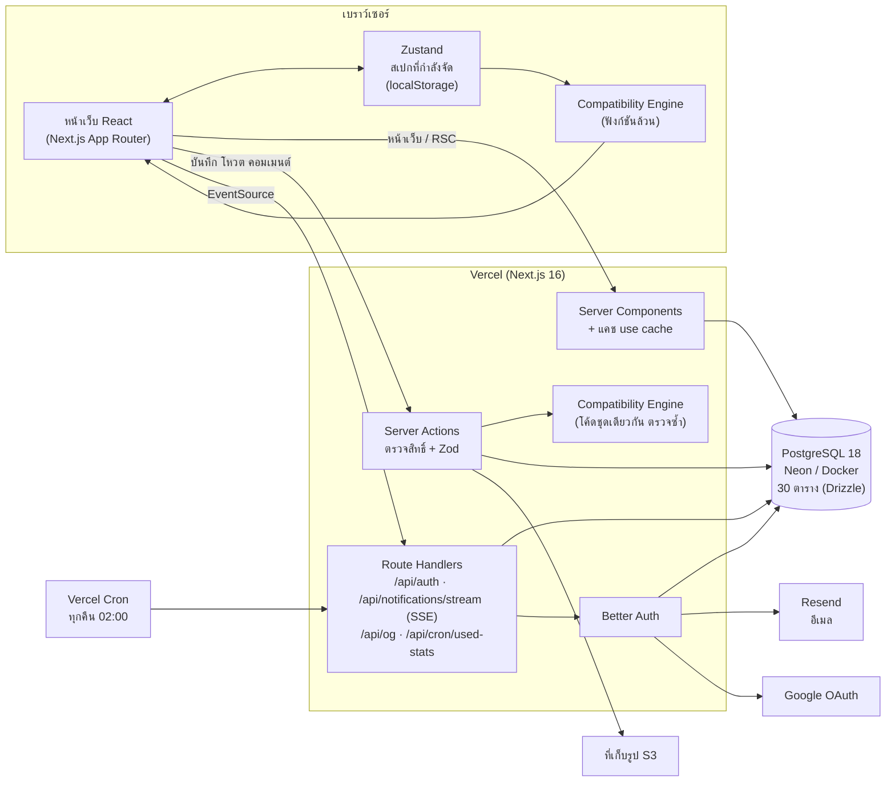

## ER Diagram ภาพรวม 30 ตาราง

สร้างจาก Schema ของ Drizzle อัตโนมัติ แสดงเฉพาะ PK และ FK · ไฟล์ต้นฉบับ `docs/diagrams/er-overview.mmd`

```mermaid
erDiagram
  accounts {
    text id PK
    text user_id FK
  }
  sessions {
    text id PK
    text user_id FK
  }
  users {
    text id PK
  }
  verifications {
    text id PK
  }
  brands {
    serial id PK
  }
  categories {
    serial id PK
  }
  part_price_history {
    serial id PK
    integer part_id FK
    text changed_by FK
  }
  parts {
    serial id PK
    integer category_id FK
    integer brand_id FK
  }
  case_specs {
    integer part_id PK,FK
  }
  cooler_specs {
    integer part_id PK,FK
  }
  cpu_specs {
    integer part_id PK,FK
  }
  gpu_specs {
    integer part_id PK,FK
  }
  motherboard_specs {
    integer part_id PK,FK
  }
  psu_specs {
    integer part_id PK,FK
  }
  ram_specs {
    integer part_id PK,FK
  }
  storage_specs {
    integer part_id PK,FK
  }
  build_items {
    serial id PK
    text build_id FK
    integer part_id FK
  }
  build_votes {
    text build_id PK,FK
    text user_id PK,FK
  }
  builds {
    text id PK
    text user_id FK
    text forked_from_id FK
  }
  comments {
    serial id PK
    text build_id FK
    text user_id FK
    integer parent_id FK
  }
  favorites {
    text user_id PK,FK
    text build_id PK,FK
  }
  admin_logs {
    bigserial id PK
    text admin_id FK
  }
  notifications {
    serial id PK
    text user_id FK
    text actor_id FK
    text build_id FK
  }
  rate_limits {
    varchar key PK
  }
  reports {
    serial id PK
    text reporter_id FK
    text resolved_by FK
  }
  settings {
    varchar key PK
    text updated_by FK
  }
  part_used_prices {
    serial id PK
    integer part_id FK
    text updated_by FK
  }
  part_used_stats {
    integer part_id PK,FK
    used_grade grade PK
  }
  price_alerts {
    serial id PK
    text user_id FK
    integer part_id FK
  }
  used_price_reports {
    serial id PK
    integer part_id FK
    text user_id FK
    text reviewed_by FK
  }
  users ||--o{ accounts : "user_id"
  users ||--o{ sessions : "user_id"
  parts ||--o{ part_price_history : "part_id"
  users |o--o{ part_price_history : "changed_by"
  categories ||--o{ parts : "category_id"
  brands ||--o{ parts : "brand_id"
  parts ||--o| case_specs : "part_id"
  parts ||--o| cooler_specs : "part_id"
  parts ||--o| cpu_specs : "part_id"
  parts ||--o| gpu_specs : "part_id"
  parts ||--o| motherboard_specs : "part_id"
  parts ||--o| psu_specs : "part_id"
  parts ||--o| ram_specs : "part_id"
  parts ||--o| storage_specs : "part_id"
  builds ||--o{ build_items : "build_id"
  parts ||--o{ build_items : "part_id"
  builds ||--o{ build_votes : "build_id"
  users ||--o{ build_votes : "user_id"
  users ||--o{ builds : "user_id"
  builds |o--o{ builds : "forked_from_id"
  builds ||--o{ comments : "build_id"
  users ||--o{ comments : "user_id"
  comments |o--o{ comments : "parent_id"
  users ||--o{ favorites : "user_id"
  builds ||--o{ favorites : "build_id"
  users |o--o{ admin_logs : "admin_id"
  users ||--o{ notifications : "user_id"
  users |o--o{ notifications : "actor_id"
  builds |o--o{ notifications : "build_id"
  users |o--o{ reports : "reporter_id"
  users |o--o{ reports : "resolved_by"
  users |o--o{ settings : "updated_by"
  parts ||--o{ part_used_prices : "part_id"
  users |o--o{ part_used_prices : "updated_by"
  parts ||--o{ part_used_stats : "part_id"
  users ||--o{ price_alerts : "user_id"
  parts ||--o{ price_alerts : "part_id"
  parts ||--o{ used_price_reports : "part_id"
  users |o--o{ used_price_reports : "user_id"
  users |o--o{ used_price_reports : "reviewed_by"
```

## ER Diagram กลุ่มผู้ใช้

หัวข้อ 6.1 · ไฟล์ต้นฉบับ `docs/diagrams/er-users.mmd`

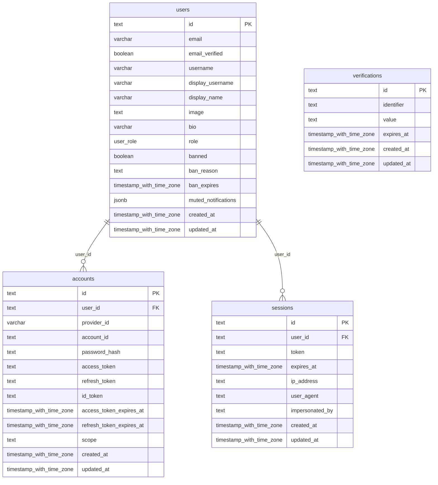

## ER Diagram กลุ่มอะไหล่และสเปก

หัวข้อ 6.2–6.3 ตารางสเปกแต่ละหมวดสัมพันธ์ 1:1 กับ parts · ไฟล์ต้นฉบับ `docs/diagrams/er-parts.mmd`

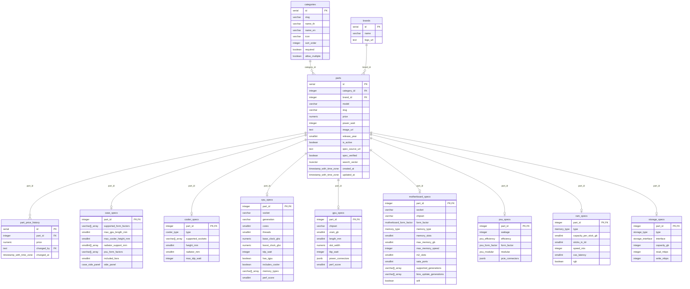

## ER Diagram กลุ่มสเปกและชุมชน

หัวข้อ 6.4 · ไฟล์ต้นฉบับ `docs/diagrams/er-builds.mmd`

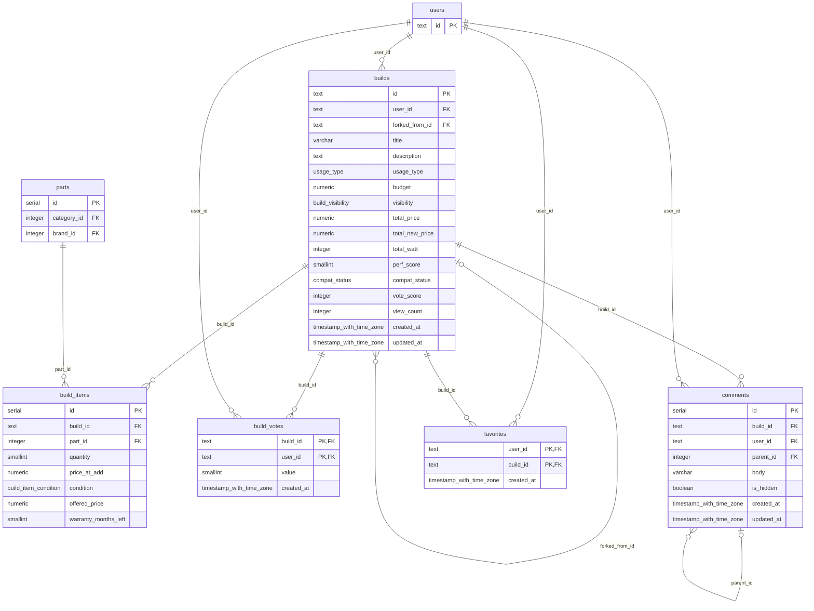

## ER Diagram กลุ่มระบบ

หัวข้อ 6.5 · ไฟล์ต้นฉบับ `docs/diagrams/er-system.mmd`

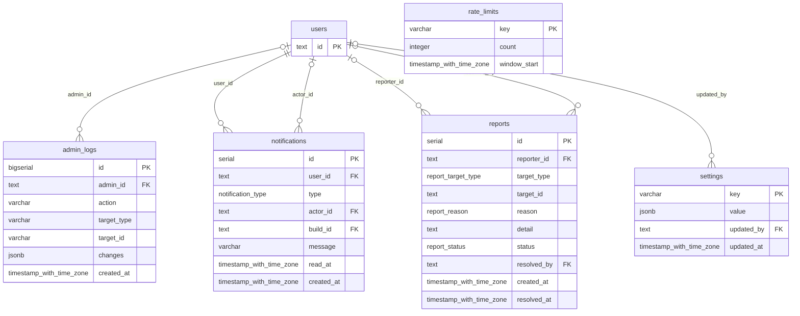

## ER Diagram กลุ่มมือสอง

หัวข้อ 6.8 · ไฟล์ต้นฉบับ `docs/diagrams/er-used.mmd`

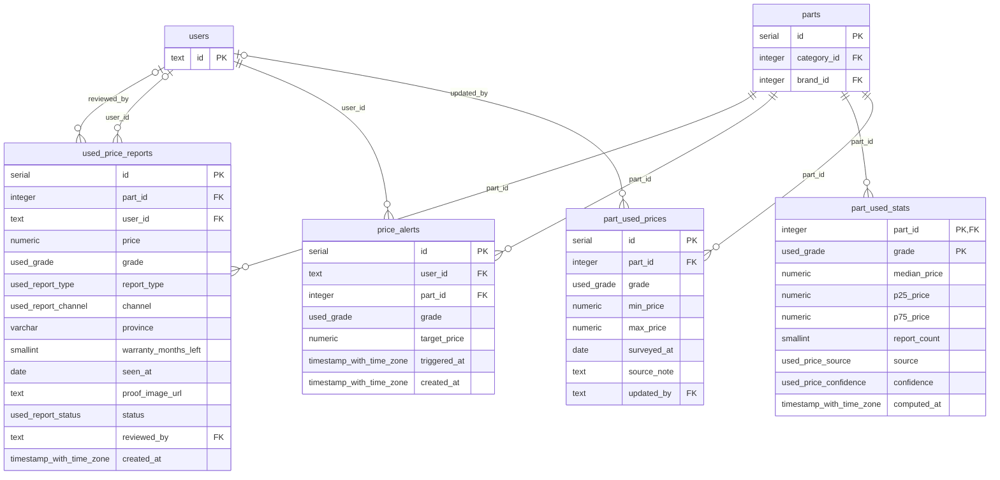

## Flowchart การตรวจความเข้ากันได้

checkBuild() หัวข้อ 4.2 · ไฟล์ต้นฉบับ `docs/diagrams/flow-check.mmd`

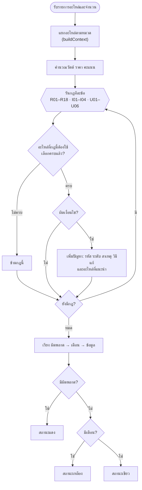

## Flowchart อัลกอริทึมจัดสเปกตามงบ

หัวข้อ 4.5 · ไฟล์ต้นฉบับ `docs/diagrams/flow-budget.mmd`

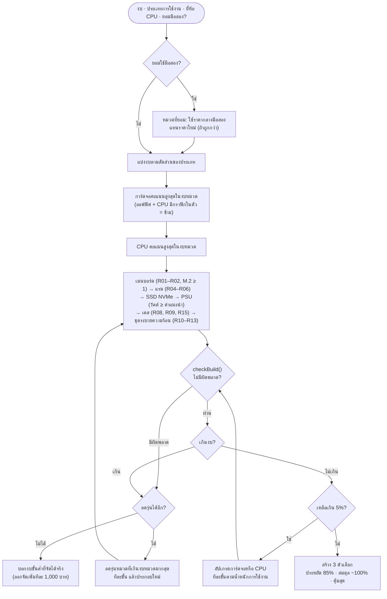

## Flowchart เลือกแหล่งราคากลางมือสอง

หัวข้อ 4.6 · ไฟล์ต้นฉบับ `docs/diagrams/flow-used-price.mmd`

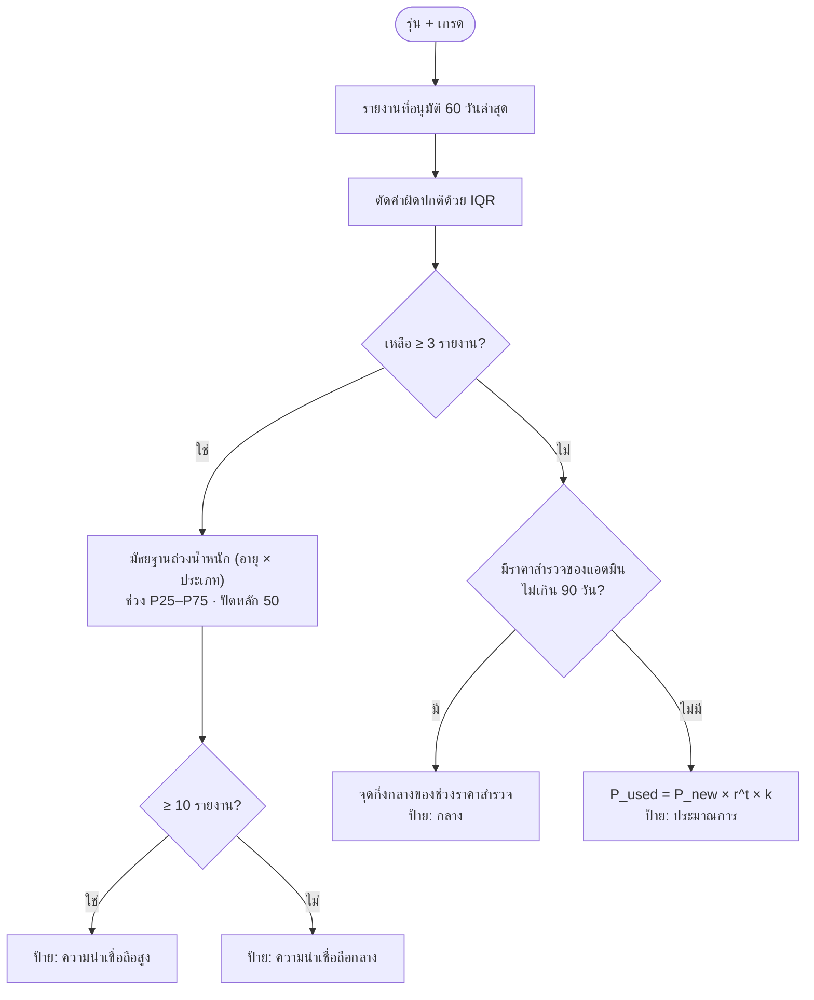

## Sequence Diagram เลือกอะไหล่และบันทึกอัตโนมัติ

หัวข้อ 8.1 · ไฟล์ต้นฉบับ `docs/diagrams/seq-save.mmd`

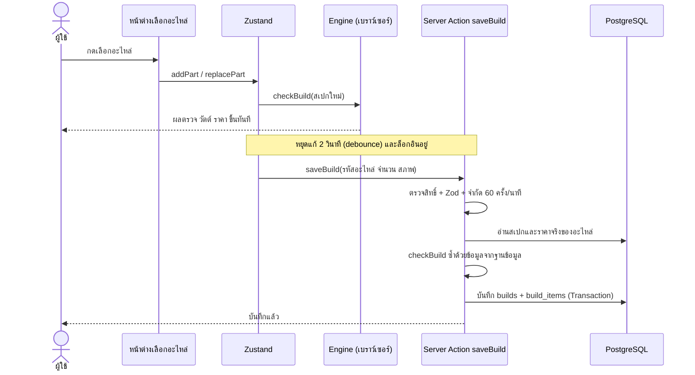

## Sequence Diagram แจ้งเตือนแบบสด

SSE หัวข้อ 3.8 · ไฟล์ต้นฉบับ `docs/diagrams/seq-notify.mmd`

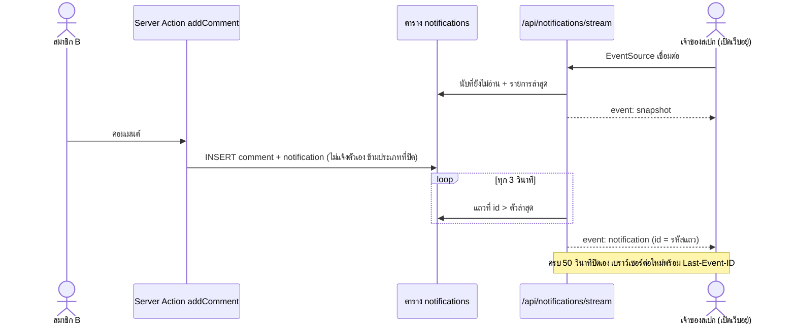
